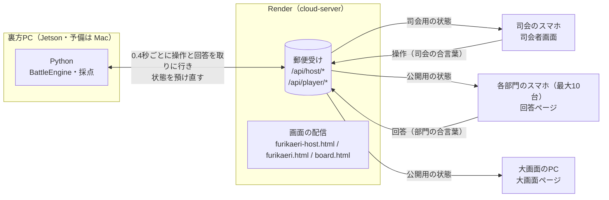

# 振り返り会スズリーグ 設計書

高専祭本番の仕組みに「部門対抗モード」を足す。全部門が同じ問題に同時に答えるので、1チームずつ回す今の進行（`engine.GameEngine`）は曲げずに、別の進行クラスを作る。大画面は Scratch のステージ画面をやめて新しい HTML にし、クラウド変数も使わない。通信は Render の HTTPS API（郵便受け）だけで足りる。

ルールと日程は [plan.md](./plan.md) にある。この文書は作り方だけを書く。

## 高専祭本番との違い

| | 高専祭本番 | 部門対抗モード |
|---|---|---|
| 答える順 | 4チームが1チームずつ5問 | 最大10部門が同じ6問に同時に |
| 1問の流れ | 出題 → 回答 → 正解発表 | 出題 → 回答 → **予想オープン** → 正解発表 → 途中順位 |
| 回答の入力 | ステージの iPad（Scratch のテンキー） | 部門ごとのスマホ（部門の回答ページ `furikaeri.html`。合言葉は部門ごと） |
| 大画面 | Scratch から作ったステージ画面（`/stage/view/`） | 新しく作る大画面ページ（`/board.html`） |
| 全員への配信 | クラウド変数 | 公開用の状態（`GET /api/player/state`）を1秒ごとに読む |
| 観客ページ | 使う | 使わない |
| 0になったら | 残りをエキシビションで回す | 脱落。そのまま答え続け、減らなくなる |

大画面をクラウド変数でなく HTTPS で読むのは、10部門の予想や残りバルーンを数値1つに詰める必要がなくなるからだ。遅れは最大1〜2秒だが、司会が「次へ」を押してから話し始めるまでの間に収まる。Scratch を通さないので、`stage.py` での作り直しも Scratch 担当への依頼も要らない。

## 全体の構成



裏方PCが状態を預け、各画面がそれを読む形は高専祭本番の司会者画面と同じで、`host.py` の中継（`HostRelay`）をそのまま使う。

## 進行（BattleEngine）

新しいモジュール `src/suzuleague/battle.py` に `BattleEngine` を置く。`GameEngine` と同じく通信を知らない純粋なロジックにし、「次へ」で1段階ずつ進む。

### 状態

| 値 | 名前 | 大画面に出るもの | 「次へ」で進む先 |
|---|---|---|---|
| 0 | `IDLE` | 参加部門の一覧とルール | `QUESTION`（1問目） |
| 2 | `QUESTION` | 問題文 | `ANSWERING` |
| 3 | `ANSWERING` | 問題文と、部門ごとの「回答済み」の印（数字は出さない） | `OPEN` |
| 9 | `OPEN` | 全部門の予想を並べる | `REVEAL` |
| 4 | `REVEAL` | 正解を出し、部門ごとにバルーンを減らす | `ROUND_RESULT` |
| 5 | `ROUND_RESULT` | 途中順位 | `QUESTION`（次の問題）か `FINISHED`（6問目のあと） |
| 8 | `FINISHED` | 最終順位と優勝部門 | なし |

値は既存の `State` とそろえ、予想オープンだけ新しく 9 を使う。司会者画面や保存ファイルの読み書きで、同じ数字が同じ意味になるようにするため。`TEAM_INTRO`（1）・`TEAM_RESULT`（6）・`EXHIBITION_ANSWERING`（7）は使わない。

`QUESTION` と `ANSWERING` を分けたのは、問題を読み上げている間に答えを送られると、話し合いの時間に差が出るため。`ANSWERING` に入って初めて回答ページの送信ボタンが押せる。

### 回答の受け付け

- `submit_answer(team_no, value)` で受け付ける。受け付けは `ANSWERING` のときだけで、締め切りまでは何度でも上書きできる
- `ANSWERING` から `OPEN` へは、**脱落していない参加部門が全部答えたときだけ**進める。足りなければ `GameError` を返し、司会者画面に「まだの部門：〇〇、△△」と出す。高専祭本番の「回答がないと正解発表に進めない」と同じ考え方で、司会の押し間違いを防ぐ
- 脱落した部門の回答は任意にする。答えていなくても進め、大画面には「―」と出す
- 答えない部門が残ったまま止まらないよう、司会者画面に「未回答のまま締め切る」ボタンを置く。押すと確認を1回はさみ、まだの部門を未回答として `OPEN` に進む。部門のスマホが落ちたまま誰も気づかない、という場面で進行が止まるのを防ぐため
- 1つの部門で2台のスマホが同じ合言葉を使っても弾かない。後から届いた回答で上書きし、司会者画面には最後に届いた数字を出す
- 締め切った回答は `OPEN` で初めて公開用の状態に入れる。`ANSWERING` の間に他の部門の数字が見えると、まねされるため

### 採点

`REVEAL` に進むときに1回だけ採点する。

```
誤差     = |正解 − 予想|
減る数   = min(誤差, 残りバルーン)       # 0 より下にはしない
誤差合計 += 誤差                          # 脱落後も足し続ける（脱落した部門どうしの順位に使う）
```

脱落した部門は、答えていても減る数を 0 にし、誤差だけを足す。未回答は、脱落しているかどうかにかかわらず**予想 50 とみなして**採点する。誤差を一律 50 にする案もあったが、正解が 50 に近い問題で答えなかった部門のほうが得をする場合があり、それよりは「真ん中を答えたことにする」ほうが参加者に説明しやすい。

### 順位

1. 残りバルーンが多い順
2. 残りバルーンが同じなら同率。0 の部門どうしだけは、誤差合計が小さい順に並べる
3. 優勝は 1 位の部門すべて。全部門が 0 なら、誤差合計が最小の部門を優勝にする（この扱いは暫定。[plan.md](./plan.md) の未決事項）

同率の順位は「1位・1位・3位」の付け方にする。

### 参加部門の切り替え

`teams-furikaeri.json` に10部門をすべて書き、当日来なかった部門は `IDLE` のあいだに司会者画面から外す。`BattleEngine` は部門ごとに `active` を持ち、1問目に進んだ時点で固定する。外した部門は大画面にも順位にも出さない。

### 問題

`questions.py` に `FURIKAERI_QUESTIONS` を足す。ID は 201〜206、予備は 207〜。高専祭本番（1〜20）・予備（101〜）・リハーサル（91〜98）と重ねない。全部門が同じ問題を解くので、`QuestionSet.for_team()` は使わず、問題の並びをそのまま `BattleEngine` に渡す。

リハーサル用に、架空の問題2問の `FURIKAERI_REHEARSAL_QUESTIONS`（ID 291〜292）も作る。前日までの試験で本番の問題を参加者に見せないため。

## 回答の受け付け経路

### 部門ごとの合言葉

合言葉は、チームごとに合言葉を発行する今の `TeamCodes` を使い、桁数だけ6桁にする。高専祭本番は登壇中の1チームの合言葉だけが有効だったが、今回は10部門ぶんが当日ずっと有効になるため、4桁では総当たりで当たりやすい（30回間違えると30秒止める仕組みのもとで、1時間に当たる見込みが4桁なら8割を超え、6桁なら2%ほど）。ただし今の `TeamCodes` は、アプリを「最初から」で起動するたびに作り直す。部門対抗モードでは合言葉を事前にカードへ印刷するので、作り直されるとカードが使えなくなる。初回に作った合言葉を `launcher/furikaeri-codes.json`（Git 管理外。公開リポジトリなので入れない）に書き出し、2回目からはそれを読む。作り直したいときはこのファイルを消す。

置き場所を `launcher/run/` にしなかったのは、Jetson との行き来のためだ。`launcher/run/` は Jetson にコードを送るときに対象から外しているので、Mac と Jetson で別々の合言葉ができてしまう。`launcher/` に置けばコードと一緒に Jetson へ届く。ただし Jetson で先に作ると、次に Mac から送ったときに消える（送る側にないファイルは消す設定のため）。合言葉は必ず Mac で先に作っておく（11/12 に作成済み）。

変えるのは cloud-server 側の照合だ。今は預かった状態の `player_code`（いま登壇中のチームの合言葉1つ）と比べているが、部門対抗モードでは `player_codes`（部門番号 → 合言葉）を預け、送られた合言葉がどの部門のものかを探す。見つかったら、その部門番号を付けて回答を郵便受けに積む。

| 変更する場所 | 中身 |
|---|---|
| `cloud-server/src/hostApi.js` の `pushPlayerAnswer` | `player_codes` があれば、合言葉から部門番号を探して `team` を付ける。なければ今までどおり `player_code` と比べる |
| 同 `POST /api/player/check`（新設） | 合言葉だけを送り、部門名を返す。回答ページで、答える前に「〇〇部門として回答します」と出すため。間違いは回答と同じく数えて、1分に30回で30秒止める |
| `host.py` の `_check_player_answer` | 部門対抗モードでは、付いてきた部門番号と合言葉が合っているか、いまの問題への回答かを確かめる |

`player_codes` は司会用の状態にだけ入れ、公開用の状態には入れない。今の `player_code` と同じ扱いだ。

### 司会者画面からの代理入力

部門を選んで数字を入れる形にする。合言葉の入れ間違いやスマホの電池切れでも、司会が口頭で聞けば止まらない。今の代理入力は「いまのチーム」に決め打ちなので、部門を選ぶ欄を足す。

## 画面

### 大画面ページ（board.html・新規）

プロジェクターに映す、入力のない画面。`src/suzuleague/board.html` に作り、`publish.py` で cloud-server の `public/` に書き出す。1秒ごとに `GET /api/player/state` を読み、状態の番号に合わせて表示を切り替える。

部門のカードを5列×2段に並べる。16:9 の画面では、横に5枚並べたほうが3列×4段より1枚が大きく取れるため。どのカードにも部門名・残りバルーン（数字と横棒）・予想を出す。部門名は最長の「ステージイベント」「ゲームイベント」（7〜8文字）が1行に収まる大きさにする。部門が10に満たないときは空いた枠を出さず、2段に振り分けて中央に寄せる（9なら5と4、7なら4と3）。

| 状態 | 画面上部 | 部門のカード |
|---|---|---|
| `IDLE` | タイトルとルール3行 | 部門名と100 |
| `QUESTION` | 「第n問」と問題文 | 残りバルーン |
| `ANSWERING` | 問題文 | 答えた部門に「回答済み」の印 |
| `OPEN` | 問題文 | 予想の数字を大きく |
| `REVEAL` | 正解を大きく | 予想・誤差・減ったバルーン。脱落した部門は灰色にする |
| `ROUND_RESULT` | 「第n問 終了」 | 順位順に並べ替える |
| `FINISHED` | 優勝部門 | 最終順位 |

`REVEAL` では、正解の数字を出してから約3秒かけて、各部門の残りバルーンを数え下げる。この演出の途中で司会が「次へ」を押すと、数え下げが終わらないまま途中順位に切り替わってしまう。そこで演出の長さ（4秒）だけ「次へ」を受け付けないようにする。

高専祭本番の `reveal_hold` は「次へ」を止めるだけでなく、そのあいだ公開用の状態から正解を抜いていた。ステージ画面の演出より先に、観客ページで答えが分かってしまうのを防ぐためだ。部門対抗モードでは正解を出すのが大画面ページ自身なので、抜いてしまうと大画面に正解が出ない。実装を見ると、「次へを止める」のは `GameController` で、「正解を抜く」のは高専祭本番の状態づくり（`host.build_player_state`）だった。そこで `GameController` の待ちはそのまま使い、`battle_host.py` の状態づくりでは正解を抜かないようにした。

文字の大きさは、16:9 の画面で問題文が2行に収まり、後ろの席から部門名が読めることを目安にする。11/20 までに横長のブラウザで一度確かめる。

### 高専祭本番の画面には手を入れない

回答ページと司会者画面は、高専祭本番の `player.html`・`host.html` を直さず、部門対抗モード用に `furikaeri.html`・`furikaeri-host.html` を新しく作った。どちらも状態の形と操作がほとんど違い、1つのページに分岐を入れると本番の画面まで壊しやすいためだ。

既存の2ページには、部門対抗モードの状態（`mode` が `battle`）が届いたら新しいページへ切り替える1行だけを足した。司会がいつもの `host.html` を開いても、部門の入力係が `player.html` を開いても、正しい画面に行き着く。

### 部門の回答ページ（furikaeri.html・新規）

1. 合言葉を入れると `POST /api/player/check` で部門名が返り、「〇〇部門」と画面の上に出し続ける
2. `ANSWERING` のときだけテンキーと送信ボタンが使える。送ったあとも締め切りまでは直せる
3. `OPEN` 以降は、自分の部門の予想・正解・残りバルーンを出す

合言葉は端末に覚えさせ（`localStorage`）、開き直しても入れ直さなくてよいようにする。部門対抗モードかどうかは、公開用の状態の `mode` で見分ける。

### 司会者画面（furikaeri-host.html・新規）

- `IDLE` のとき、部門ごとの参加・不参加のスイッチを出す
- `ANSWERING` のとき、部門ごとの回答状況（済み・まだ）と、届いた数字を出す。数字は司会にだけ見える
- 代理入力に部門を選ぶ欄を足す
- 部門ごとの合言葉の一覧を出す（合言葉カードの印刷を忘れたときの予備）

## 公開用の状態

司会用の状態の `player` の部分に、次の形で入れる。cloud-server はこの中の `accepting_answer` と `question.id` を見て回答を受け付けるので、この2つの名前は高専祭本番と変えない。

```json
{
  "mode": "battle",
  "state": 3,
  "round": 2,
  "rounds": 6,
  "question": {"id": 202, "text": "…"},
  "correct": null,
  "teams": [
    {"number": 1, "name": "〇〇部門", "balloons": 85, "answered": true, "answer": null,
     "damage": null, "error_total": 15, "eliminated": false, "rank": 2}
  ],
  "accepting_answer": true
}
```

`answer` は `OPEN` 以降、`correct` と `damage` は `REVEAL` 以降にだけ値を入れる。それより前は `null` にする。公開用の状態は誰でも読めるので、正解を先に入れないことは高専祭本番と同じく試験で確かめる（`tests/test_battle_host.py`）。

## 保存と再開

`savefile.py` に部門対抗モードの読み書きを足し、`launcher/run/game-furikaeri.json` に保存する。中身は状態・何問目か・部門ごとの参加・残りバルーン・誤差合計・回答の履歴・合言葉。裏方PCを開き直したら、高専祭本番と同じく「続きから／最初から」を選べる。

## 既存のコードとの分け方

`host.py`・`savefile.py`・`dashboard.py` はどれも `GameEngine` を前提に書かれている。ここに `if` で部門対抗モードを差し込むと、高専祭本番の分岐と混ざって読めなくなる。部門対抗モード用の状態づくりと操作の実行は `battle_host.py` に分けて置き、`host.py` の中継（`HostRelay`）からは、どちらを呼ぶかを起動時に1回決めるだけにする。

`GameController` の「次へ」は `advance()` と `state` しか使っていないので、`BattleEngine` も同じ名前で持たせればそのまま通る。部門ごとの回答・参加の切り替え・締め切りは「次へ」に収まらないので、ロックの中でエンジンを操作して保存まで行う `apply()` を `GameController` に1つ足し、`battle_host.py` からはそれを使う。CLI の画面表示（rich で描く一覧）は部門対抗モードでは1行の状態表示だけにする。本番はアプリから `--headless` で動かすので、凝った表示は要らない。

## 起動

| 経路 | 指定 |
|---|---|
| CLI | `uv run suzuleague --battle --teams teams-furikaeri.json`（試験用の架空の問題は `--battle --rehearsal`） |
| `スズリーグ.app` | モードの選択肢に「振り返り会」「振り返り会（リハーサル）」を足す。`app.sh` のモード名は `furikaeri` と `furikaeri-rehearsal` |

`--battle` のときはクラウド変数の接続（`CloudBridge`）を作らない。司会者画面の中継だけを動かす。今の `--offline` は中継まで止めてしまうので、それとは別のフラグにする。

## 手元で通す

Render を使わずに、Mac だけで全部の画面を通せる。予備の司会者画面（`--web`）が、回答ページと大画面も配り、回答の受け付けも cloud-server と同じ照合で行う。

```bash
uv run suzuleague --battle --rehearsal --offline --web --teams teams-furikaeri.json
```

`http://localhost:8000/host`（司会者画面）・`/board.html`（大画面）・`/furikaeri.html`（回答ページ）を開く。11/12 にこの形で、10部門のうち1つを不参加にして2問を最後まで通した。

## 作るものの一覧

| ファイル | 種類 | 中身 |
|---|---|---|
| `src/suzuleague/battle.py` | 新規 | `BattleEngine`（状態・回答・採点・順位） |
| `src/suzuleague/battle_host.py` | 新規 | 部門対抗モードの公開用・司会用の状態、操作の実行（参加の切り替え・代理入力・締め切り）、回答の照合 |
| `src/suzuleague/questions.py` | 追記 | `FURIKAERI_QUESTIONS`・`FURIKAERI_REHEARSAL_QUESTIONS` |
| `src/suzuleague/engine.py` | 追記 | `State.OPEN = 9`。`labels.py` にも表示名を足す |
| `src/suzuleague/battle_app.py` | 新規 | `--battle` の起動と、ターミナルの最小限の表示 |
| `src/suzuleague/controller.py` | 追記 | `apply()`（エンジンへの操作をロックの中で行い、保存する） |
| `src/suzuleague/host.py` | 改修 | 中継と予備の画面が、状態づくりと操作の実行を差し替えられるようにする。予備の画面（`--web`）でも回答ページと大画面を開けるようにし、cloud-server の `/api/player/*` をまねる |
| `src/suzuleague/savefile.py` | 改修 | 部門対抗モードの保存と読み込み |
| `src/suzuleague/dashboard.py` | 改修 | `--battle` の起動 |
| `src/suzuleague/board.html` | 新規 | 大画面ページ |
| `src/suzuleague/furikaeri.html` | 新規 | 部門の回答ページ |
| `src/suzuleague/furikaeri-host.html` | 新規 | 部門対抗モードの司会者画面 |
| `src/suzuleague/player.html`・`host.html` | 1行追記 | 部門対抗モードなら新しいページへ切り替える |
| `src/suzuleague/publish.py` | 改修 | 新しい3ページを書き出しの対象に入れる |
| `launcher/app.sh` ほか | 改修 | モードの追加 |
| `teams-furikaeri.json` | 作成済み | 10部門の名前（11/12） |
| cloud-server `src/hostApi.js` | 改修 | `player_codes` での照合、`POST /api/player/check` |

司会者画面が送る操作の種類には `set_active`（部門の参加切り替え）と `close`（未回答のまま締め切る）を足す。cloud-server の `COMMAND_TYPES` にも同じものを足す。

## 試験

| 試験 | 確かめること |
|---|---|
| `tests/test_battle.py` | 状態の進み方、全員が答えるまで `OPEN` に進めないこと、締め切り、採点（減る数の下限・脱落後の誤差の足し方・未回答を予想50とみなすこと）、順位（同率・脱落した部門の並び）、1問目以降は参加を変えられないこと |
| `tests/test_battle_host.py` | 公開用の状態に、`OPEN` より前の予想と `REVEAL` より前の正解が入らないこと。`REVEAL` の待ちのあいだも正解が入っていること。合言葉と部門番号が合わない回答を弾くこと。合言葉が起動し直しても変わらないこと |
| `tests/test_savefile.py` | 部門対抗モードを保存して読み直すと、同じ状態に戻ること |
| cloud-server `src/tests/hostApi.test.js` | `player_codes` での照合、`/api/player/check`、間違いが続いたときの停止 |
| 手での通し試験 | ブラウザのタブ10個で10部門を模擬し、本番の Render で6問を通す。大画面を横長のブラウザで見る |

既存の試験（`GameEngine` まわり）も今のまま全部通すこと。部門対抗モードを足したことで、高専祭本番の動きが変わっていないかを見るため。

## 作らないもの

観客ページ・観客ランキングは使わないので手を付けない。Scratch のステージ画面（`stage.py`）にも触らない。Scratch 担当が 10/25 に更新した版を取り込む作業も、今回は見送る。
